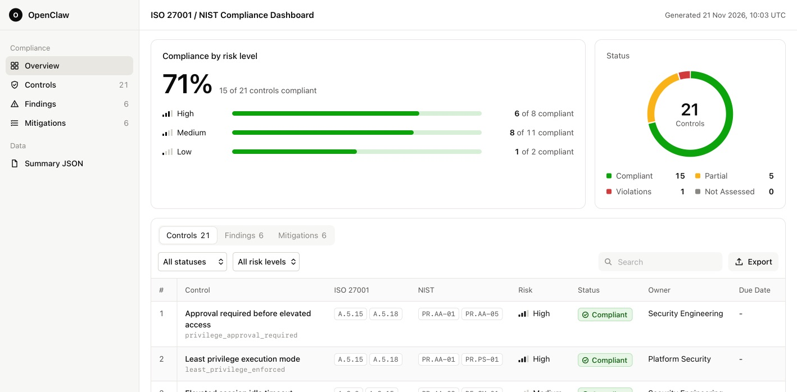
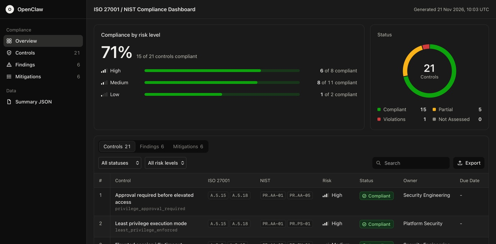
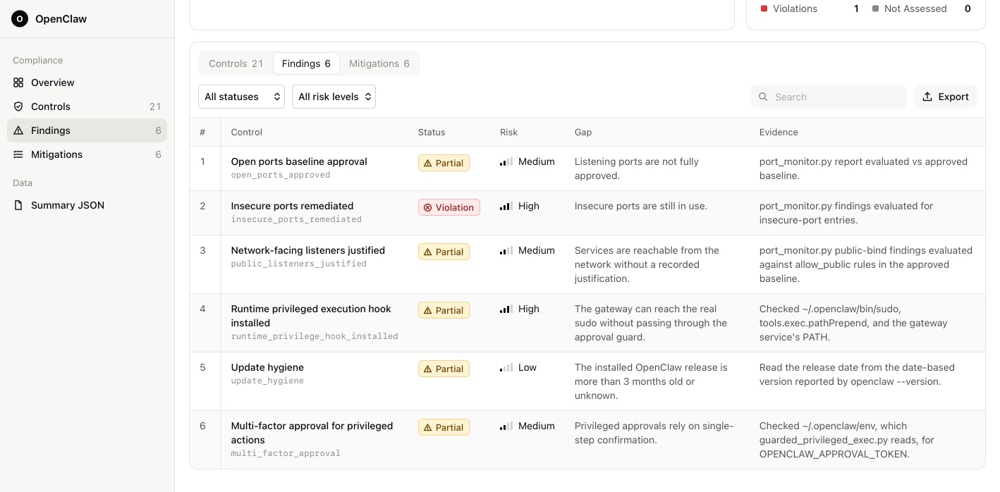
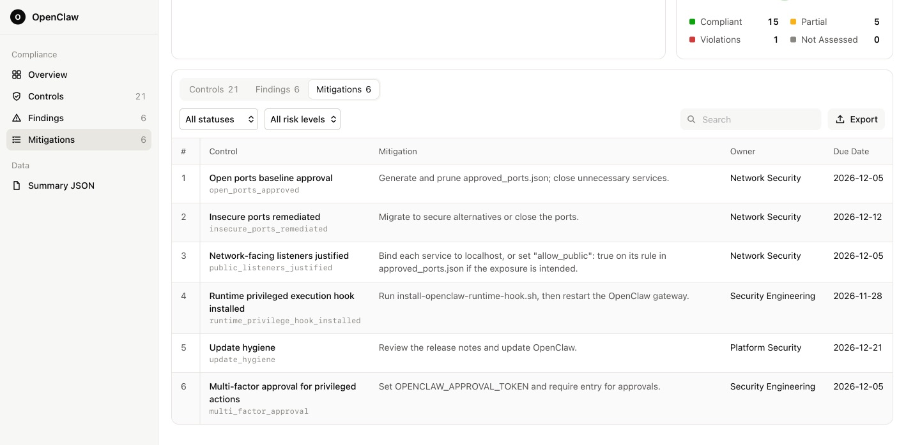

# OpenClaw Cyber Analyst

[](https://github.com/FletcherFrimpong/OpenClaw-Cyber-Analyst/actions/workflows/tests.yml)
[](LICENSE)


A security layer for [OpenClaw](https://openclaw.ai). It makes the agent ask you
before it runs anything as root, watches what your machine exposes to the network,
and scores the setup against ISO 27001 and NIST CSF in a dashboard you can open in
a browser.



In plain terms, it helps you:

- Ask for approval before risky system-level actions
- Track open ports and outbound network connections
- See what is wrong, how to fix it, and by when

## Contents

- [Who this is for](#who-this-is-for)
- [5-minute start](#5-minute-start)
- [The dashboard](#the-dashboard)
- [How it works](#how-it-works)
- [The 21 controls](#the-21-controls)
- [Core protections](#core-protections)
- [What this does not protect against](#what-this-does-not-protect-against)
- [Optional features](#optional-features)
- [Files it writes](#files-it-writes)
- [Updating](#updating) and [uninstalling](#uninstalling)
- [Troubleshooting](#troubleshooting)
- [Development](#development)

## Who This Is For

- Non-technical users who want safer defaults
- Technical users who want stronger control and auditability

## 5-Minute Start

You need `python3` (3.9 or newer) and `npm`. Run these commands from the project folder:

```bash
./scripts/bootstrap-openclaw-cyber-analyst.sh
./scripts/auto-invoke-security-cycle.sh
./scripts/open-dashboard.sh
```

1. **Bootstrap** installs OpenClaw if it is missing, applies safe gateway defaults,
   installs the skill, and asks whether to run the security cycle every 30 minutes
   in the background.
2. **The security cycle** scans the machine and writes the reports.
3. **Open dashboard** serves the report on this machine only and prints its address:
   `http://127.0.0.1:8088/compliance-dashboard.html`

## The Dashboard

The overview shows how many controls pass, split by risk level, and the status of all
of them at a glance. It follows your system's light or dark theme.



**Findings** lists every control that is not compliant, with the gap and the evidence
behind it.



**Mitigations** lists what to do about each one, who owns it, and the due date. An
open control keeps the due date it was first given; a control that passes has nothing
outstanding.



Every table can be filtered by status and risk, searched, paged 10 rows at a time,
and exported to CSV. The page is a single self-contained file with no external
assets, so it opens offline.

The screenshots show example data, not a real machine.

## How It Works

```mermaid
flowchart LR
    subgraph ask["When the agent wants root"]
        A[sudo command] --> B[sudo shim]
        B --> C{Command policy}
        C -- denied --> X[Blocked and logged]
        C -- allowed --> D{You approve<br/>at the terminal}
        D -- no --> X
        D -- yes --> E[sudo asks for<br/>your password]
        E --> F[Command runs,<br/>elevation dropped]
        F --> L[(Hash-chained<br/>audit log)]
        X --> L
    end

    subgraph watch["Every 30 minutes"]
        P[Port monitor] --> R[Assessment]
        Q[Egress monitor] --> R
        S[Guard self-tests] --> R
        L --> R
        R --> T[Dashboard and<br/>JSON summary]
        R --> N[Alert on new findings]
    end
```



There are two halves:

- **The guard** sits in front of privileged commands. It checks the command against
  your policy, asks you at the terminal, lets sudo ask for your password, runs the
  command, drops the elevation, and records every step.
- **The security cycle** runs on a schedule. It scans listening ports and OpenClaw's
  outbound connections, tests that the guard still refuses what it should, and writes
  the dashboard.

## The 21 Controls

Each control is checked against what can be observed or exercised on your machine. A
control is compliant only when its check passes.

| Control | ISO 27001 | NIST CSF | Risk | How it is checked |
| --- | --- | --- | --- | --- |
| Approval required before elevated access | A.5.15, A.5.18 | PR.AA-01, PR.AA-05 | High | Self-test: approval is refused with no terminal, and a forged session file is discarded |
| Least privilege execution mode | A.5.15, A.5.18 | PR.AA-01, PR.PS-01 | High | OpenClaw is not running as root and its state is correctly owned |
| Elevated session idle timeout | A.8.2, A.8.15 | PR.AA-03, DE.CM-01 | Medium | Self-test: a session idle for 31 minutes is dropped |
| Privileged action audit logging | A.8.15, A.8.16 | DE.AE-03, DE.CM-01 | Medium | The audit log has entries and its hash chain verifies |
| Open ports baseline approval | A.8.20, A.8.21 | PR.PS-02, DE.CM-01 | Medium | Every listening port matches a rule in the baseline |
| Insecure ports remediated | A.8.20, A.8.21 | PR.PS-02, PR.DS-02 | High | No listener on legacy plaintext ports such as 21, 23 or 80 |
| Network-facing listeners justified | A.8.20, A.8.22 | PR.PS-02, PR.IR-01 | Medium | A service on all interfaces has `allow_public` in its rule |
| Channel allowlist configured | A.5.15, A.5.16 | PR.AA-02 | High | A channel restricts who can message the agent (`allowFrom`) |
| Group mention requirement | A.5.16 | PR.AA-04 | Medium | Group chats need an explicit mention |
| Gateway bound to loopback | A.8.9, A.8.10 | PR.IP-01 | High | Gateway is local, bound to loopback, with token auth |
| Secrets and config permissions hardened | A.8.11 | PR.DS-01 | Medium | `~/.openclaw` and its config are readable only by you |
| Runtime privileged execution hook installed | A.5.15, A.5.18 | PR.AA-01 | High | The sudo shim exists and OpenClaw finds it before the real sudo |
| Privilege escalation outside the guard restricted | A.5.15 | PR.AA-05 | Medium | sudo cannot be used without a password |
| Backup and recovery configured | A.8.13 | PR.IP-04 | Low | A backup exists in `~/.openclaw/backups` |
| Update hygiene | A.8.8 | ID.RA-01 | Low | The installed OpenClaw release is no more than 3 months old |
| Prompt injection controls | A.5.15, A.5.18 | PR.AA-01 | High | Untrusted content needs confirmation before a privileged action |
| Privileged command policy enforced | A.5.15 | PR.AA-05 | High | The command policy has allow or deny rules |
| Task session boundary enforced | A.5.15 | PR.AA-03 | Medium | Approvals are tied to a task session ID |
| Multi-factor approval for privileged actions | A.5.17 | PR.AA-02 | Medium | An approval token is required as well as the prompt |
| Outbound allowlist configured | A.8.20 | PR.PS-02 | Medium | The egress allowlist has rules |
| Outbound connections approved | A.8.20 | DE.CM-01 | Medium | Every outbound OpenClaw connection matches the allowlist |

The mapping lives in `cyber-security-engineer/references/compliance-controls-map.json`.

## Core Protections

### 1) Approval Before Privileged Actions

Privileged commands should be run through:

```bash
python3 cyber-security-engineer/scripts/guarded_privileged_exec.py \
  --reason "why privileged access is needed" \
  --use-sudo \
  -- systemctl restart nginx
```

This provides:

- **Approval at the terminal.** You are asked on your terminal, not through the
  program's input, so a script cannot answer for you. With no terminal, the command is refused.
- **sudo's own password prompt, every time.** Cached sudo credentials are discarded first.
- **Command policy checks** (if configured). A broken policy file blocks everything.
- **Automatic drop back to normal mode** after the command.
- **A tamper-evident audit log** at `~/.openclaw/security/privileged-audit.jsonl`.
  Check it with `python3 cyber-security-engineer/scripts/audit_logger.py verify`.

Only root-owned programs can be run this way. A program your user can overwrite
(for example one installed by Homebrew) is refused, because it could be swapped
before it runs as root.

A command policy is a list of patterns for commands that must never run as root:

```json
{
  "deny": ["\\brm\\s+-rf\\b", "\\bshutdown\\b", "\\bvisudo\\b"]
}
```

Save it as `~/.openclaw/security/command-policy.json`. A fuller starting point is in
`cyber-security-engineer/references/command-policy.template.json`.

### 2) Open Port Monitoring

Generate an approved baseline from current listeners:

```bash
python3 cyber-security-engineer/scripts/generate_approved_ports.py
```

This creates `~/.openclaw/security/approved_ports.json`. Review it and remove
anything you do not recognise. Each rule looks like this:

```json
{ "port": 18789, "protocol": "tcp", "command": "node", "comment": "OpenClaw gateway" }
```

- A service that listens on every network interface is reported until you set
  `"allow_public": true` on its rule.
- For a service that picks a new port each time it starts, use `"port": "*"` with a `command`.
- Only TCP is scanned by default. Add `--include-udp` to `port_monitor.py` to list UDP too.

Starter template: `cyber-security-engineer/references/approved_ports.template.json`

### 3) Outbound Network Monitoring

Check OpenClaw's outbound TCP connections against your allowlist:

```bash
python3 cyber-security-engineer/scripts/egress_monitor.py
```

Only real egress from OpenClaw is evaluated:

- OpenClaw's own processes (the gateway and anything it starts), not the rest of the machine
- Outbound connections only, not clients connecting in to the gateway
- Destinations that leave the host, not loopback or link-local traffic

Useful options:

| Option | Effect |
| --- | --- |
| `--json` | Machine-readable report |
| `--scope all` | Evaluate every process on the host, not just OpenClaw |
| `--include-local` | Also evaluate loopback and link-local destinations |
| `--no-resolve` | Make no DNS queries; use remembered answers only |
| `--fail-on-findings` | Exit with status 3 if anything unapproved is found |

The allowlist is `~/.openclaw/security/egress_allowlist.json`. Each rule names a
destination and, ideally, why it is allowed:

```json
[
  {
    "protocol": "tcp",
    "host": "api.openai.com",
    "port": 443,
    "comment": "Model provider"
  }
]
```

Rules accept `host`/`hosts` (hostname or IP), `cidr`, `host_regex`, `port`/`ports` and `command`.
Hostnames are resolved through DNS so they can be compared with the IP addresses the
operating system reports; answers are remembered for 7 days.

If the report shows `evaluated: 0`, OpenClaw was idle or not running and nothing was checked.

Starter template and full reference:

- `cyber-security-engineer/references/egress-allowlist.template.json`
- `cyber-security-engineer/references/egress-monitoring-policy.md`

## What This Does Not Protect Against

This is a guard on privileged (root) actions and a reporting tool. It is not a sandbox.

- It does not limit what the agent can do as your own user without root.
- If your user can run sudo without a password, the strongest control here is gone.
  The dashboard reports that as a violation.
- The scripts, policies and logs live in your account, so a process running as you
  can change them. The audit log detects partial edits, not wholesale replacement.
- Port and egress checks report every 30 minutes. They do not block anything.

The full list, and which controls hold against what, is in
[the threat model](cyber-security-engineer/references/threat-model.md).

## Optional Features

### Runtime Hook for `sudo` (opt-in)

This installs a guarded `sudo` shim so that ordinary `sudo` calls made by the
OpenClaw gateway go through the approval guard.
It is **not installed by default**. To enable it during bootstrap:

```bash
ENFORCE_PRIVILEGED_EXEC=1 ./scripts/bootstrap-openclaw-cyber-analyst.sh
```

Or install it standalone:

```bash
./cyber-security-engineer/scripts/install-openclaw-runtime-hook.sh
openclaw gateway restart
```

The installer sets OpenClaw's `tools.exec.pathPrepend` so the shim is found before the
real sudo. The shim can be removed at any time by deleting `~/.openclaw/bin/sudo`.

### Stricter Approval

Put these in `~/.openclaw/env` (one `NAME=value` per line, file mode 600):

| Setting | Effect |
| --- | --- |
| `OPENCLAW_APPROVAL_TOKEN=<secret>` | A second secret must be typed at each approval |
| `OPENCLAW_REQUIRE_SESSION_ID=1` | Each privileged command needs `OPENCLAW_TASK_SESSION_ID` set by the caller |
| `OPENCLAW_REQUIRE_POLICY_FILES=1` | Privileged execution is refused until all policy files exist |

### Notification on New Findings

You can send alerts when new violations/partials appear:

- `OPENCLAW_VIOLATION_NOTIFY_CMD`
  - Command that receives the message on stdin
- `OPENCLAW_VIOLATION_NOTIFY_ALLOWLIST`
  - Allowed notifier commands
  - Supports exact JSON argv rules (recommended) or legacy comma-separated binaries

For example, to write new findings to the system log:

```bash
export OPENCLAW_VIOLATION_NOTIFY_CMD='["/usr/bin/logger", "-t", "openclaw-security"]'
export OPENCLAW_VIOLATION_NOTIFY_ALLOWLIST='[["/usr/bin/logger", "-t", "openclaw-security"]]'
```

Shells and interpreters are refused as notifiers.

## Files It Writes

Everything stays under `~/.openclaw/`. Nothing is written to system directories.

| Path | What it is |
| --- | --- |
| `~/.openclaw/workspace/skills/cyber-security-engineer/` | The installed skill |
| `.../cyber-security-engineer/assessments/` | Reports: dashboard, JSON summary, port and egress scans |
| `~/.openclaw/security/approved_ports.json` | Your port baseline |
| `~/.openclaw/security/command-policy.json` | Your command policy |
| `~/.openclaw/security/egress_allowlist.json` | Your egress allowlist |
| `~/.openclaw/security/prompt-policy.json` | Untrusted-content confirmation setting |
| `~/.openclaw/security/privileged-audit.jsonl` | Hash-chained audit log (rotated at 5 MB) |
| `~/.openclaw/security/root-session-state.json`, `session-state.key` | Signed session state and its key |
| `~/.openclaw/security/egress-dns-cache.json` | Remembered DNS answers for allowlisted hosts |
| `~/.openclaw/bin/sudo` | The opt-in sudo shim |
| `~/.openclaw/logs/cyber-security-engineer-auto.log` | Log of scheduled runs |

The only network use is DNS lookups of the hostnames in your egress allowlist.

## Updating

The scheduled security cycle runs the installed copy of the skill, not this folder.
After pulling changes, update the installed copy:

```bash
git pull
./scripts/install-skill.sh
```

Changes are listed in [CHANGELOG.md](CHANGELOG.md).

## Uninstalling

```bash
./scripts/uninstall.sh
```

This removes the scheduled cycle, the sudo shim and the installed skill. Your policy
files and audit log in `~/.openclaw/security` are kept unless you add `--purge`.
OpenClaw itself is not touched.

## Troubleshooting

| What you see | Why | What to do |
| --- | --- | --- |
| The dashboard does not change after a code change | The cycle runs the installed copy, and reports are written there | Run `./scripts/install-skill.sh`, then the cycle again |
| `Approval must be given at a terminal` | The guard was run with no terminal attached, for example from a script | Run the command yourself in a terminal |
| `command binary is not root-owned` | The program can be overwritten by your user, so it is not allowed to run as root | Use the system's copy of the tool, or run it without the guard |
| `Command blocked by policy` on everything | The command policy file is unreadable or has an invalid pattern | Fix `~/.openclaw/security/command-policy.json` |
| The hook control is partial | The shim exists but OpenClaw does not find it before the real sudo | Run `install-openclaw-runtime-hook.sh`, then `openclaw gateway restart` |
| A port is flagged again after a reboot | The service picked a new port | Use `"port": "*"` with a `command` in its rule |
| Egress report shows `evaluated: 0` | OpenClaw was idle or not running | Nothing was checked; look again when the agent is active |
| `openclaw` fails with a Node version error | Recent OpenClaw releases need Node 24.16 or newer | Install a supported Node, then `openclaw gateway install --force` |

## Platforms

| Platform | Status |
| --- | --- |
| macOS | Developed and used on macOS |
| Linux | Supported; covered by automated tests, not yet used day to day |
| Windows | Through WSL only; the scheduler script is untested on a real machine |

## Development

```
cyber-security-engineer/     The skill OpenClaw loads
  SKILL.md                   Instructions for the agent
  scripts/                   Guard, monitors, assessment and dashboard
  references/                Policies, templates, controls map, threat model
scripts/                     Install, schedule, uninstall and dashboard helpers
tests/                       Unit tests for every script
```

Run the tests from the project folder (no network access or OpenClaw install needed):

```bash
python3 -m unittest discover -s tests -v
```

The same tests run on Linux and macOS, on Python 3.9 and 3.13, for every push.

## Security

To report a vulnerability, see [SECURITY.md](SECURITY.md).

## Licence

[MIT](LICENSE)

## Common Terms

- Privileged command
  - A command that needs elevated system permissions
- Baseline
  - The approved list of expected behavior (for example approved ports)
- Egress
  - Outbound network traffic from your machine
- Compliance dashboard
  - A report view mapped to ISO 27001 and NIST checks
