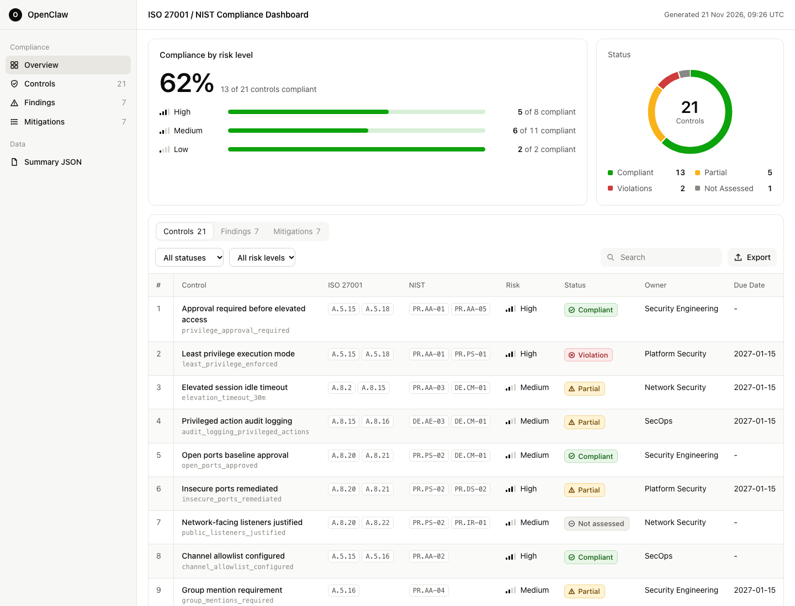

# OpenClaw Cyber Analyst

[](https://github.com/FletcherFrimpong/OpenClaw-Cyber-Analyst/actions/workflows/tests.yml)

This project adds a security layer to OpenClaw.

In plain terms, it helps you:

- Ask for approval before risky system-level actions
- Track open ports and outbound network connections
- Generate a security report you can review in a browser



## Who This Is For

- Non-technical users who want safer defaults
- Technical users who want stronger control and auditability

## 5-Minute Start (Non-Technical)

You need `python3` (3.9 or newer) and `npm`. Run these commands from the project folder:

```bash
./scripts/bootstrap-openclaw-cyber-analyst.sh
./scripts/auto-invoke-security-cycle.sh
./scripts/open-dashboard.sh
```

The first command installs OpenClaw if it is missing, applies safe gateway defaults,
installs the skill, and asks whether to run the security cycle every 30 minutes in
the background. The last command prints the dashboard's address:

- `http://127.0.0.1:8088/compliance-dashboard.html`

## What You Will See

After each security cycle, these files are updated in
`~/.openclaw/workspace/skills/cyber-security-engineer/assessments/`:

- `compliance-dashboard.html`
  - Human-friendly report page
- `compliance-summary.json`
  - Structured summary for tools/integrations
- `openclaw-assessment.json`
  - Control checklist and status
- `port-monitor-latest.json`
  - Latest open-port scan
- `egress-monitor-latest.json`
  - Latest outbound connection scan

The dashboard scores 21 controls mapped to ISO 27001 and NIST CSF. Each control is
checked against what can be observed on your machine. A control shows as compliant
only when the check passes, and an open control shows what is wrong, how to fix it,
and a due date.

## Core Protections

### 1) Approval Before Privileged Actions

Privileged commands should be run through:

```bash
python3 cyber-security-engineer/scripts/guarded_privileged_exec.py \
  --reason "why privileged access is needed" \
  --use-sudo \
  -- systemctl restart nginx
```

This provides:

- **Approval at the terminal.** You are asked on your terminal, not through the
  program's input, so a script cannot answer for you. With no terminal, the command is refused.
- **sudo's own password prompt, every time.** Cached sudo credentials are discarded first.
- **Command policy checks** (if configured). A broken policy file blocks everything.
- **Automatic drop back to normal mode** after the command.
- **A tamper-evident audit log** at `~/.openclaw/security/privileged-audit.jsonl`.
  Check it with `python3 cyber-security-engineer/scripts/audit_logger.py verify`.

Only root-owned programs can be run this way. A program your user can overwrite
(for example one installed by Homebrew) is refused, because it could be swapped
before it runs as root.

### 2) Open Port Monitoring

Generate an approved baseline from current listeners:

```bash
python3 cyber-security-engineer/scripts/generate_approved_ports.py
```

This creates:

- `~/.openclaw/security/approved_ports.json`

Review it and remove anything you do not recognise. A service that listens on every
network interface is reported until you set `"allow_public": true` on its rule.

Starter template:

- `cyber-security-engineer/references/approved_ports.template.json`

Only TCP is scanned by default. Add `--include-udp` to `port_monitor.py` to list UDP too.

### 3) Outbound Network Monitoring

Check OpenClaw's outbound TCP connections against your allowlist:

```bash
python3 cyber-security-engineer/scripts/egress_monitor.py
```

Only real egress from OpenClaw is evaluated:

- OpenClaw's own processes (the gateway and anything it starts), not the rest of the machine
- Outbound connections only, not clients connecting in to the gateway
- Destinations that leave the host, not loopback or link-local traffic

Useful options:

| Option | Effect |
| --- | --- |
| `--json` | Machine-readable report |
| `--scope all` | Evaluate every process on the host, not just OpenClaw |
| `--include-local` | Also evaluate loopback and link-local destinations |
| `--no-resolve` | Make no DNS queries; use remembered answers only |
| `--fail-on-findings` | Exit with status 3 if anything unapproved is found |

Allowlist path:

- `~/.openclaw/security/egress_allowlist.json`

Each rule names a destination and, ideally, why it is allowed:

```json
[
  {
    "protocol": "tcp",
    "host": "api.openai.com",
    "port": 443,
    "comment": "Model provider"
  }
]
```

Rules accept `host`/`hosts` (hostname or IP), `cidr`, `host_regex`, `port`/`ports` and `command`.
Hostnames are resolved through DNS so they can be compared with the IP addresses the
operating system reports; answers are remembered for 7 days in
`~/.openclaw/security/egress-dns-cache.json`.

If the report shows `evaluated: 0`, OpenClaw was idle or not running and nothing was checked.

Starter template and full reference:

- `cyber-security-engineer/references/egress-allowlist.template.json`
- `cyber-security-engineer/references/egress-monitoring-policy.md`

## What This Does Not Protect Against

This is a guard on privileged (root) actions and a reporting tool. It is not a sandbox.

- It does not limit what the agent can do as your own user without root.
- If your user can run sudo without a password, the strongest control here is gone.
  The dashboard reports that as a violation.
- The scripts, policies and logs live in your account, so a process running as you
  can change them. The audit log detects partial edits, not wholesale replacement.
- Port and egress checks report every 30 minutes. They do not block anything.

The full list, and which controls hold against what, is in
[the threat model](cyber-security-engineer/references/threat-model.md).

## Optional Features

### Runtime Hook for `sudo` (opt-in)

This installs a guarded `sudo` shim so that ordinary `sudo` calls made by the
OpenClaw gateway go through the approval guard.
It is **not installed by default**. To enable it during bootstrap:

```bash
ENFORCE_PRIVILEGED_EXEC=1 ./scripts/bootstrap-openclaw-cyber-analyst.sh
```

Or install it standalone:

```bash
./cyber-security-engineer/scripts/install-openclaw-runtime-hook.sh
```

Then reload the gateway service so it picks up the new PATH. On macOS a plain
`openclaw gateway restart` is not enough:

```bash
launchctl bootout gui/$(id -u)/ai.openclaw.gateway
launchctl bootstrap gui/$(id -u) ~/Library/LaunchAgents/ai.openclaw.gateway.plist
```

The shim can be removed at any time by deleting `~/.openclaw/bin/sudo`.

### Stricter Approval

Put these in `~/.openclaw/env` (one `NAME=value` per line, file mode 600):

| Setting | Effect |
| --- | --- |
| `OPENCLAW_APPROVAL_TOKEN=<secret>` | A second secret must be typed at each approval |
| `OPENCLAW_REQUIRE_SESSION_ID=1` | Each privileged command needs `OPENCLAW_TASK_SESSION_ID` set by the caller |
| `OPENCLAW_REQUIRE_POLICY_FILES=1` | Privileged execution is refused until all policy files exist |

### Notification on New Findings

You can send alerts when new violations/partials appear:

- `OPENCLAW_VIOLATION_NOTIFY_CMD`
  - Command that receives the message on stdin
- `OPENCLAW_VIOLATION_NOTIFY_ALLOWLIST`
  - Allowed notifier commands
  - Supports exact JSON argv rules (recommended) or legacy comma-separated binaries

## Updating

The scheduled security cycle runs the installed copy of the skill, not this folder.
After pulling changes, update the installed copy:

```bash
git pull
./scripts/install-skill.sh
```

Changes are listed in [CHANGELOG.md](CHANGELOG.md).

## Uninstalling

```bash
./scripts/uninstall.sh
```

This removes the scheduled cycle, the sudo shim and the installed skill. Your policy
files and audit log in `~/.openclaw/security` are kept unless you add `--purge`.
OpenClaw itself is not touched.

## Platforms

| Platform | Status |
| --- | --- |
| macOS | Developed and used on macOS |
| Linux | Supported; covered by automated tests, not yet used day to day |
| Windows | Through WSL only; the scheduler script is untested on a real machine |

## Development

Run the tests from the project folder (no network access or OpenClaw install needed):

```bash
python3 -m unittest discover -s tests -v
```

The same tests run on Linux and macOS for every push.

## Security

To report a vulnerability, see [SECURITY.md](SECURITY.md).

## Licence

[MIT](LICENSE)

## Common Terms

- Privileged command
  - A command that needs elevated system permissions
- Baseline
  - The approved list of expected behavior (for example approved ports)
- Egress
  - Outbound network traffic from your machine
- Compliance dashboard
  - A report view mapped to ISO 27001 and NIST checks
